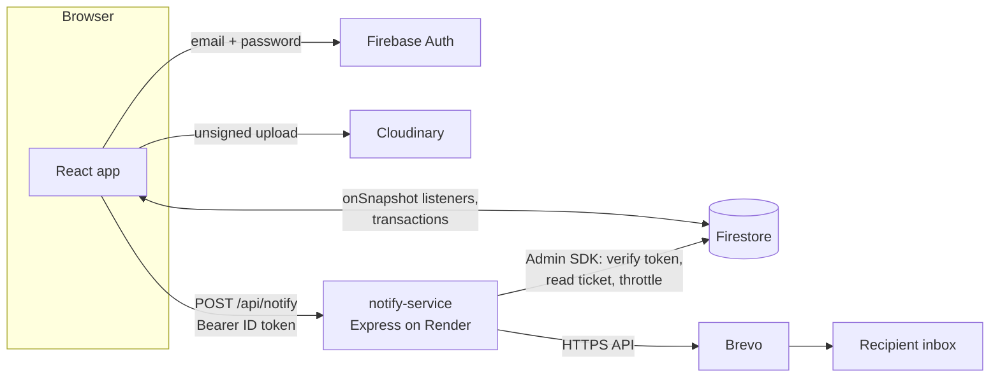

# CarePal Support

Support tickets and live chat between families and TheCarePal's home-care operations team,
built for take-home task FS-07.

- **Live demo:** https://carepal-74c9f.web.app
- **Demo video:** _link coming soon_
- **Demo logins** (synthetic data): open the live demo and click **Try as a family member** or
  **Try as support agent**. No typing needed.

| Role | Email | Who |
| --- | --- | --- |
| Family member | `priya.sharma@demo.carepal.test` | Priya Sharma (dementia care for her mother) |
| Support staff (admin) | `anjali@demo.carepal.test` | Anjali Rao |

## Screenshots

| Member, mobile | Admin inbox, desktop |
| --- | --- |
| _screenshot coming soon_ | _screenshot coming soon_ |

Desktop before/after shots of the member side are in [`docs/screenshots/`](docs/screenshots/).

## Features

### Must-haves from the brief

- ✅ **Create a ticket**: category, priority, subject, description and an optional photo
  (compressed in the browser, uploaded to Cloudinary).
- ✅ **Real-time chat on every ticket**: messages show up on both sides within a second, with
  day separators and system messages ("Assigned to Meera").
- ✅ **Admin inbox**: Pending / In progress / Resolved / All tabs; filters for category, priority and
  assignee (me, unassigned, anyone on the team); sorting; search by member, subject or
  ticket number; assign to
  any team member or "Assign to me"; status changes.
- ✅ **Unread badges on both sides**: per ticket, in the nav, and in the browser tab title.
- ✅ **Live wait timer**: how long the ticket has waited since the last reply, coloured by SLA.
- ✅ **Saved quick replies**: admins manage them; staff insert one from the composer (type `/`),
  with `{{memberName}}`, `{{ticketNo}}` and `{{agentName}}` filled in and editable before
  sending.

### Bonus

- ✅ **Email on new reply** through a small Express service. A staff reply emails the member; a
  member reply emails the assignee, or the support inbox if nobody is assigned. Throttled per
  ticket and recipient.
- ✅ **Satisfaction rating**: on a resolved ticket the member rates 1–5 with an optional
  comment; staff see the rating and the CSAT average in the inbox.

### Also included

- Responsive: phone layout first (works at 360px), two-pane workspaces on desktop.
- Inbox stats strip: open tickets, waiting on us, longest wait, CSAT.
- Offline banner, error boundary, loading skeletons and empty and error states everywhere.
- Accessible: labelled inputs, visible focus, focus-trapped dialogs, status shown as text and
  not only colour.

## Tech stack, and why

| Part | Choice | Why |
| --- | --- | --- |
| Web app | React 18 + Vite, React Router 6, Tailwind CSS 3 | Matches TheCarePal's React stack; fast builds; consistent styling without a design system to maintain. |
| Data + auth | Firebase Auth (email/password) + Firestore | Real-time listeners out of the box, security rules instead of a custom API, free Spark plan. |
| Real-time | Firestore `onSnapshot` | No socket server to run or scale; offline cache and reconnects for free. |
| Photos | Cloudinary unsigned upload preset | Firebase Storage and Cloud Functions need the paid Blaze plan; Cloudinary's free tier covers this. |
| Email | Express `notify-service` (Render) + Brevo HTTP API | Verifies the caller's Firebase ID token, re-reads the ticket with the Admin SDK, and throttles. Render's free tier blocks SMTP ports, so production sends over HTTPS through Brevo; local dev can use SMTP. |
| Tests | Vitest (web), `node --test` (notify-service) | Pure logic (timers, filters, stats, placeholders, email policy) is unit-tested. |

## Architecture



**Data model** (exact field names are in [CLAUDE.md](CLAUDE.md)):

- `users/{uid}`: name, email, phone, role (`member` / `agent` / `admin`), city, careType.
- `tickets/{ticketId}`: ticket number `TCP-XXXXXX`, member fields, category, priority, subject,
  description, photoUrl, status, assignee, timestamps, and the denormalised chat state used by
  the lists: `lastMessage*`, `awaitingReplyFrom`, `waitingSince`, `unreadMember`, `unreadStaff`,
  `rating`, and `lastEmailAt` (server-only).
- `tickets/{ticketId}/messages/{messageId}`: `message` or `system`, sender, text, createdAt.
  Messages can't be edited or deleted.
- `quickReplies/{id}`: title, body with placeholders, category (or `any`).

## How it works

**Sending a message is one transaction.** It reads the ticket, creates the message, and updates
the ticket's last-message fields, the other side's unread counter and the wait state together.
So the inbox row, badges and timer can never disagree with the thread. The first staff reply on
a pending ticket also moves it to In progress and writes the system message in the same
transaction.

**Unread counters are per side.** `unreadStaff` counts member messages the team hasn't seen;
`unreadMember` counts staff messages the family hasn't seen. Opening a thread resets only your
own side's counter, and skips the write when it's already 0. System messages never count.

**The wait timer** runs from the oldest unanswered message. `waitingSince` is set when the
conversation turns to the other side and isn't moved by follow-ups ("any update?" doesn't
reset the clock). Waiting on staff shows a chip: green under 15 minutes, amber under 60, red
after. Waiting on the member is neutral ("Awaiting member · 3h"). Resolved tickets show
nothing. Every timer on screen reads one shared clock that ticks every 30 seconds, not one
interval per row.

**Security rules** ([`firestore.rules`](firestore.rules)) are the API boundary:

- Members read only their own tickets and messages. They can create a ticket only in its exact
  initial shape (pending, unassigned, unread 1, server timestamps, Cloudinary-only photo URL).
- On an existing ticket a member can make only three kinds of change: the fields a message
  send touches (on an open ticket, incrementing `unreadStaff` by exactly 1), resetting their own
  unread counter to 0, or rating a resolved ticket once.
- Members can't change status, assignee, priority or anyone else's data; nobody can delete
  tickets or edit messages.
- Staff can update tickets but not the member's identity, the ticket number, the rating or
  `lastEmailAt`. Only admins can write quick replies. `lastEmailAt` is written only by the
  notify-service.

**Resolving** clears the wait state and stamps `resolvedAt`. The member sees a banner, a
"Raise a new ticket" button and the rating card. Staff can reopen, which restarts the
staff-side wait timer.

## Run it locally

**Prerequisites:** Node 20.19+ and npm; a Firebase project; a free Cloudinary account.

1. **Firebase:** create a project, enable **Authentication → Email/Password**, and create a
   **Firestore** database. Register a web app and copy its config.
2. **Cloudinary:** create an **unsigned** upload preset (images only, 5 MB limit). See
   [docs/DEPLOY.md](docs/DEPLOY.md#3-cloudinary-upload-preset).
3. **Service account** (for the seed script and the notify-service): Firebase console →
   Project settings → Service accounts → Generate new private key → save it as
   `scripts/service-account.json`. It is gitignored. Never commit it.
4. **Env files:** copy each `.env.example` to `.env` and fill it in:
   - `web/.env`: Firebase config, Cloudinary cloud name and preset, `VITE_NOTIFY_URL`
     (e.g. `http://localhost:8080`, or empty to skip emails), and the demo emails and password.
   - `scripts/.env`: `SEED_PASSWORD` (8+ characters; use the same value as
     `VITE_DEMO_PASSWORD`).
   - `notify-service/.env`: `GOOGLE_APPLICATION_CREDENTIALS=../scripts/service-account.json`.
     Leave `EMAIL_ENABLED=false` to log emails instead of sending them.
5. **Rules and indexes:** set your project id in `.firebaserc`, then:

   ```bash
   npx firebase-tools deploy --only firestore:rules,firestore:indexes
   ```

6. **Seed demo data** (8 families, 3 staff, 25 tickets with conversations, 6 quick replies):

   ```bash
   cd scripts && npm install && npm run seed:reset
   ```

7. **Run:**

   ```bash
   cd web && npm install && npm run dev
   ```

   ```bash
   cd notify-service && npm install && npm run dev
   ```

8. **Checks:**

   ```bash
   cd web && npm run lint && npm test && npm run build
   ```

   ```bash
   cd notify-service && npm test
   ```

Deploying to Firebase Hosting and Render is covered in [docs/DEPLOY.md](docs/DEPLOY.md).

## Assumptions

The brief is open-ended, so I made these calls:

- **"Waiting time"** is the time since the oldest unanswered message, shown for both sides
  (SLA colours only when the team owes the reply).
- **Staff unread is per team, not per agent:** any staff member opening a ticket clears it.
- **Members can't reply on resolved tickets.** They raise a new one; staff can reopen.
- **Attachments are images only** (JPEG, PNG, WebP, HEIC), up to 5 MB, compressed in the
  browser to about 1 MB before upload.
- **The admin inbox filters client-side** over the latest 200 tickets, which keeps filters
  instant and the index count low.
- **Email is throttled** to one per ticket per recipient every 10 minutes.
- **Email is best-effort:** the web app calls the notify-service fire-and-forget, so a slow or
  sleeping service never delays the chat. The free Render instance sleeps after about 15 idle
  minutes and takes 30–50 s to wake.

## What I'd build next

- Per-agent read receipts, presence and typing indicators (Realtime Database).
- Push notifications (FCM) for TheCarePal's mobile apps.
- SLA escalation alerts when a ticket goes red.
- Attachments inside chat messages, not only on the ticket.
- Linking tickets to bookings, invoices and nurse shifts.
- Server-side search (Algolia or Typesense) beyond the latest 200 tickets.
- Quick-reply analytics and auto-suggest by category.
- An audit log of staff actions.
- Security-rules tests on the Firestore emulator.
- A persistent outbox, so a message typed offline survives a page reload.
- Hindi and Kannada translations.

## AI tools used

_To be edited by the author with specifics._

- **Claude**: planning, reviewing the data model and security rules, and writing the phase
  prompts.
- **Claude Code**: scaffolding components, rules, the seed data, the notify-service and tests,
  phase by phase.
- All code was reviewed, tested and understood by me before each commit.

## Project structure

```
.
├── web/                    React app (Vite)
│   └── src/
│       ├── firebase.js     Firebase init from VITE_* env
│       ├── constants.js    enums, labels, colours, limits
│       ├── services/       all Firestore, Cloudinary and notify writes
│       ├── hooks/          all onSnapshot listeners (each returns its unsubscribe)
│       ├── context/        auth and the shared 30 s clock
│       ├── components/     chat/, tickets/, admin/, member/, layouts/, shared UI
│       ├── pages/          Login, member/ (MyTickets, NewTicket), admin/ (Inbox, QuickReplies)
│       ├── routes/         ProtectedRoute, HomeRedirect
│       └── utils/          pure functions + Vitest tests
├── notify-service/         Express email service
│   ├── src/                config, auth middleware, /api/notify route, mailer (Brevo/SMTP)
│   └── test/
├── scripts/                seed.js + seedData.js (firebase-admin)
├── docs/                   DEPLOY.md, screenshots/
├── firestore.rules
├── firestore.indexes.json
├── firebase.json           Hosting + cache headers
└── render.yaml             notify-service Blueprint
```

## Privacy

All families, patients, nurses, tickets and messages are **synthetic**, created by the seed
script. No real patient information is used anywhere. Demo emails use the reserved `.test`
domain. Credentials live only in local `.env` files and the gitignored service-account file.
